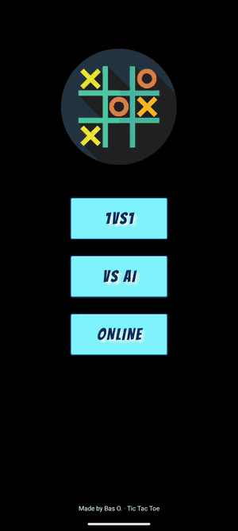
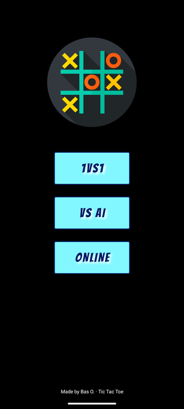
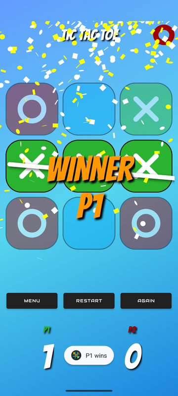
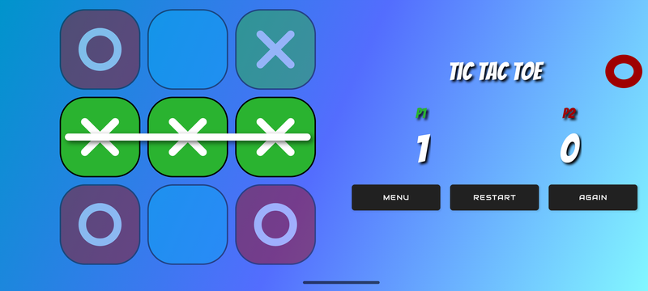
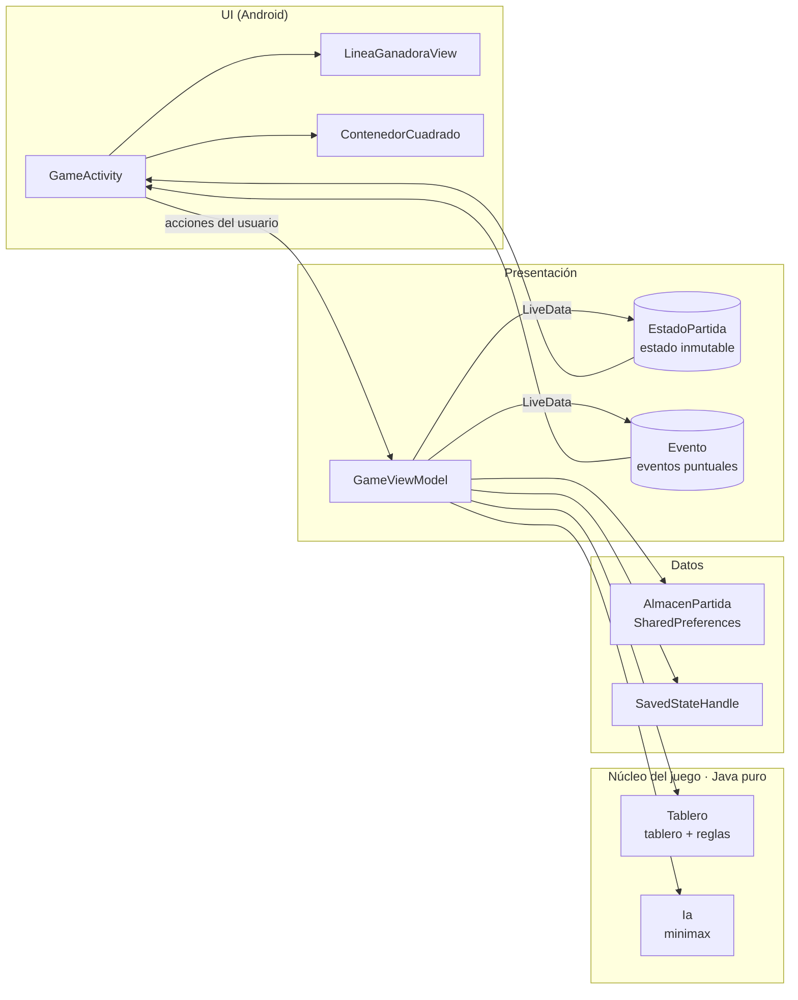

<p align="center">
  
</p>

<h1 align="center">Tres en Raya</h1>

<p align="center">
  Tres en raya nativo para Android en <b>Java</b>: modo de dos jugadores, una <b>IA imbatible con minimax</b>,
  animaciones y una arquitectura MVVM totalmente testeada.
</p>

<p align="center">
  
  
  
</p>

<p align="center">
  
</p>

## Funcionalidades

- **Dos modos de juego**: 1 contra 1 en el mismo dispositivo, o contra la IA con tres niveles de dificultad.
- **IA imbatible**: el nivel difícil usa una búsqueda minimax completa que prefiere ganar cuanto antes
  y perder lo más tarde posible, y elige al azar entre jugadas igual de buenas para que las partidas no
  se repitan. Un test unitario juega *todas las partidas posibles* contra ella y comprueba que nunca pierde.
- **Raya ganadora animada**, dibujada con una `View` propia, casillas perdedoras atenuadas, confeti y un
  cartel *WINNER* parpadeante.
- **Sensaciones**: cada ficha aparece con un pequeño rebote, la casilla ocupada tiembla y vibra, y el
  fondo es un degradado animado.
- **Personalizable**: pulsa un nombre o el título para cambiarlo y pulsa una puntuación para elegir el
  color del jugador. Nombres, colores y marcador se guardan entre sesiones, por modo de juego.
- **Aguanta todo**: giros de pantalla, multiventana y que el sistema mate el proceso (el estado vive en
  un `ViewModel` respaldado por `SavedStateHandle`).
- **Diseño adaptable**: el tablero siempre es cuadrado, con layouts específicos para vertical y
  horizontal en móviles y tablets.
- **Integración con el sistema actual**: API de SplashScreen, pantalla edge-to-edge (obligatoria desde
  Android 15) e icono adaptativo con capa monocroma para los iconos temáticos.
- **Accesible y traducida**: cada casilla tiene descripción para TalkBack ("Fila 2, columna 3: J1"),
  plurales, y textos en español e inglés.

<p align="center">
  
  &nbsp;
  
</p>
<p align="center">
  
</p>

## Arquitectura

MVVM con el núcleo del juego libre de dependencias de Android, así las reglas y la IA se testean en la
JVM en milisegundos.



| Clase | Responsabilidad |
| --- | --- |
| [`Tablero`](app/src/main/java/com/bastianorellana/tresenraya/Tablero.java) | Estado del tablero, jugadas, ganador y línea ganadora. Sin dependencias de Android. |
| [`Ia`](app/src/main/java/com/bastianorellana/tresenraya/Ia.java) | Fácil (al azar), media (ganar → bloquear → centro) y difícil (minimax). |
| [`GameViewModel`](app/src/main/java/com/bastianorellana/tresenraya/GameViewModel.java) | Flujo de la partida, turnos, marcador y turno de la IA. Publica un `EstadoPartida` inmutable. |
| [`GameActivity`](app/src/main/java/com/bastianorellana/tresenraya/GameActivity.java) | Pinta el estado y reacciona a los eventos puntuales (animaciones, vibración, celebración). |
| [`LineaGanadoraView`](app/src/main/java/com/bastianorellana/tresenraya/LineaGanadoraView.java) | Vista propia que anima la raya sobre las tres casillas ganadoras. |
| [`Programador`](app/src/main/java/com/bastianorellana/tresenraya/Programador.java) | Abstracción de tareas con retraso para poder testear la "pausa para pensar" de la IA sin `Looper`. |

## Tests

```bash
./gradlew testDebugUnitTest          # 28 tests en la JVM: tablero, IA y ViewModel
./gradlew connectedDebugAndroidTest  # Tests de Espresso que juegan partidas reales en un dispositivo o emulador
```

- **`IaTest`** recorre el árbol de juego completo (empezando la IA y empezando el rival) y comprueba que
  la IA difícil nunca pierde.
- **`GameViewModelTest`** cubre victorias, empates, casillas ocupadas, persistencia del marcador,
  recuperación tras matar el proceso y el turno de la IA con un programador manual.
- **`GameActivityTest`** (Espresso) juega una partida completa desde la interfaz y comprueba el
  marcador, el cartel del ganador, las descripciones de accesibilidad y que el marcador se conserva al
  volver a entrar.

## Compilar

Requisitos: JDK 17 o superior y el SDK de Android (plataforma 36).

```bash
./gradlew assembleDebug      # app/build/outputs/apk/debug/app-debug.apk
./gradlew assembleRelease    # minificado con R8 y recorte de recursos
```

### Firmar el APK de release

Crea un archivo `keystore.properties` (ignorado por git) en la raíz del proyecto:

```properties
storeFile=release.jks
storePassword=…
keyAlias=…
keyPassword=…
```

## Tecnologías

Java 17 · Android Views · AndroidX Lifecycle (ViewModel, LiveData, SavedStateHandle) ·
Material Components · API de SplashScreen · R8 · JUnit 4 · Espresso

Librerías: [Konfetti](https://github.com/DanielMartinus/Konfetti) (confeti),
[ColorSheet](https://github.com/msasikanth/ColorSheet) (selector de color).
Fuentes: Bangers y Audiowide (Google Fonts, licencia SIL Open Font License).

## Próximamente

- [ ] Multijugador online

---

Hecho por Bas O.
