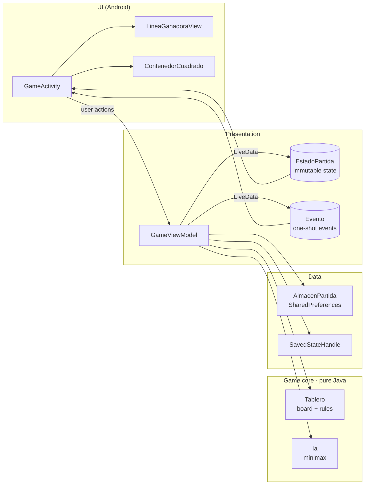

<p align="center">
  
</p>

<h1 align="center">Tres en Raya · Tic Tac Toe</h1>

<p align="center">
  Native Android tic-tac-toe in <b>Java</b>: local two-player mode, an <b>unbeatable minimax AI</b>,
  animations and a fully tested MVVM architecture.
</p>

<p align="center">
  <a href="https://github.com/basd1/3EnRaya/actions/workflows/ci.yml"></a>
  
  
  
</p>

<p align="center">
  
</p>

## Features

- **Two game modes**: 1 vs 1 on the same device, or against the AI with three difficulty levels.
- **Unbeatable AI**: the hard level uses a full minimax search that prefers quick wins and slow losses,
  and picks randomly among equally good moves so games don't repeat. A unit test plays *every possible
  game* against it and checks that it never loses.
- **Animated winning line** drawn by a custom `View`, losing squares dimmed, confetti and a blinking
  *WINNER* banner.
- **Feel**: pop-in animation for each piece, shake + haptic feedback on an occupied square, animated
  gradient background.
- **Customisable**: tap a name or the title to rename it, tap a score to pick the player's colour.
  Names, colours and scores are saved per mode between sessions.
- **Survives everything**: rotation, multi-window and process death (state lives in a `ViewModel`
  backed by `SavedStateHandle`).
- **Adaptive layouts**: the board is always square; dedicated portrait and landscape layouts for
  phones and tablets.
- **Modern platform integration**: SplashScreen API, edge-to-edge (mandatory from Android 15),
  adaptive launcher icon with a monochrome layer for themed icons.
- **Accessible and localised**: every square has a TalkBack description ("Row 2, column 3: P1"),
  plurals, Spanish and English.

<p align="center">
  
  &nbsp;
  
</p>
<p align="center">
  
</p>

## Architecture

MVVM with a framework-free game core, so the rules and the AI are tested on the JVM in milliseconds.



| Class | Responsibility |
| --- | --- |
| [`Tablero`](app/src/main/java/com/bastianorellana/tresenraya/Tablero.java) | Board state, moves, winner and winning line. No Android dependencies. |
| [`Ia`](app/src/main/java/com/bastianorellana/tresenraya/Ia.java) | Easy (random), medium (win → block → centre) and hard (minimax). |
| [`GameViewModel`](app/src/main/java/com/bastianorellana/tresenraya/GameViewModel.java) | Game flow, turns, scores, AI scheduling. Publishes an immutable `EstadoPartida`. |
| [`GameActivity`](app/src/main/java/com/bastianorellana/tresenraya/GameActivity.java) | Renders the state and reacts to one-shot events (animations, haptics, celebration). |
| [`LineaGanadoraView`](app/src/main/java/com/bastianorellana/tresenraya/LineaGanadoraView.java) | Custom view that animates the line across the three winning squares. |
| [`Programador`](app/src/main/java/com/bastianorellana/tresenraya/Programador.java) | Delayed-task abstraction so the AI "thinking" delay is testable without a `Looper`. |

## Testing

```bash
./gradlew testDebugUnitTest          # 28 JVM tests: board, AI and ViewModel
./gradlew connectedDebugAndroidTest  # Espresso tests that play real games on a device/emulator
```

- **`IaTest`** walks the whole game tree (the AI moving first and second) and asserts the hard AI
  never loses.
- **`GameViewModelTest`** covers wins, draws, occupied squares, score persistence, process-death
  restoration and the AI turn using a manual scheduler.
- **`GameActivityTest`** (Espresso) plays a full game through the UI and checks the score, the winner
  banner, the accessibility descriptions and persistence across launches.

CI runs lint, unit tests and the Espresso suite on an emulator for every push
([workflow](.github/workflows/ci.yml)).

## Building

Requirements: JDK 17+ and the Android SDK (platform 36).

```bash
./gradlew assembleDebug      # app/build/outputs/apk/debug/app-debug.apk
./gradlew assembleRelease    # minified with R8 and resource shrinking
```

### Signed releases

Pushing a tag like `v2.0.0` triggers the [release workflow](.github/workflows/release.yml), which
builds a signed APK and attaches it to a GitHub Release. It needs these repository secrets:
`SIGNING_KEYSTORE_BASE64`, `SIGNING_STORE_PASSWORD`, `SIGNING_KEY_ALIAS`, `SIGNING_KEY_PASSWORD`.

For local signed builds, create a `keystore.properties` file (ignored by git) in the project root:

```properties
storeFile=release.jks
storePassword=…
keyAlias=…
keyPassword=…
```

## Tech stack

Java 17 · Android Views · AndroidX Lifecycle (ViewModel, LiveData, SavedStateHandle) ·
Material Components · SplashScreen API · R8 · JUnit 4 · Espresso · GitHub Actions

Libraries: [Konfetti](https://github.com/DanielMartinus/Konfetti) (confetti),
[ColorSheet](https://github.com/msasikanth/ColorSheet) (colour picker).
Fonts: Bangers and Audiowide (Google Fonts, SIL Open Font License).

## Roadmap

- [ ] Online multiplayer

---

Made by Bas O.
